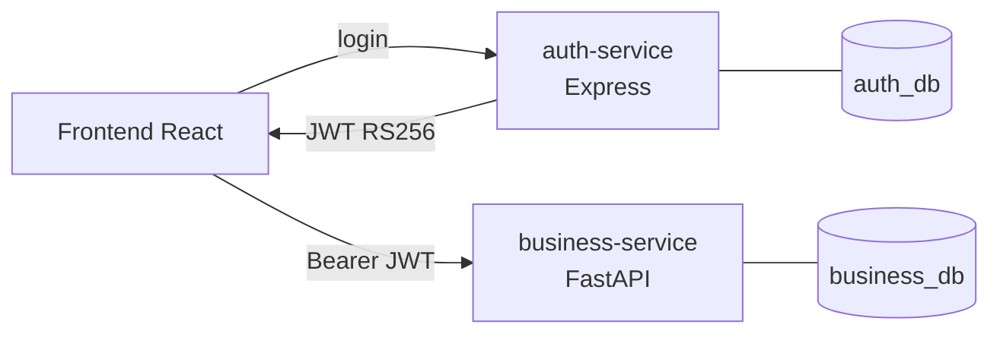

# Plataforma de gestión de reparaciones de motores de minería pesada

Aplicación web para que un taller especializado registre los motores de maquinaria de minería pesada que ingresan a sus instalaciones y haga seguimiento a su diagnóstico, reparación y entrega.

La solución sigue una **arquitectura de microservicios**: la identidad y la autenticación están separadas de la lógica de negocio.

| Componente | Tecnología | Responsabilidad |
|---|---|---|
| [`auth-service/`](auth-service) | Node.js 22 · Express 5 · TypeScript · TypeORM | Usuarios, roles, hash de contraseñas, login y **emisión** de JWT (RS256) |
| [`business-service/`](business-service) | Python 3.12 · FastAPI · SQLAlchemy 2 · Alembic | Clientes, motores, órdenes de reparación e historial; **verificación** de JWT |
| [`frontend/`](frontend) | React 18 · TypeScript · Vite · TanStack Query | Interfaz web |
| [`infra/postgres/`](infra/postgres) | PostgreSQL 16 | Una base de datos y un usuario aislado por servicio |



 **Documentación técnica**

- [Arquitectura y decisiones técnicas](docs/architecture.md)
- [Modelo de datos y reglas de integridad](docs/data-model.md)
- [Autenticación entre servicios y gestión de llaves](docs/authentication.md)
- [Endpoints principales](docs/api.md)
- [Pruebas y pipeline CI/CD](docs/testing-and-cicd.md)

---

## 1. Requisitos

| Herramienta | Versión | Para qué |
|---|---|---|
| Docker Desktop / Docker Engine + Compose v2 | 24 o superior | Ejecutar toda la plataforma |
| Node.js | 20 o superior | Generar las llaves, desarrollo local y prueba de humo |
| Python | 3.11 o superior | Solo para desarrollar business-service fuera de Docker |
| Git | — | Control de versiones |

## 2. Inicio rápido con Docker Compose (recomendado)

```bash
git clone <url-del-repositorio> motor-repair-platform
cd motor-repair-platform

cp .env.example .env               # 1. Variables de entorno (en PowerShell: Copy-Item .env.example .env)
node scripts/generate-keys.mjs     # 2. Par de llaves RSA para los JWT (en ./keys, ignoradas por git)
docker compose up -d --build       # 3. Construye y levanta los 4 contenedores
```

| Qué | URL |
|---|---|
| Aplicación web | http://localhost:5173 |
| Swagger de auth-service | http://localhost:4000/docs |
| Swagger de business-service | http://localhost:8000/docs |

**Credenciales iniciales**: las definidas en `.env` (`ADMIN_EMAIL` / `ADMIN_PASSWORD`). Por defecto son `admin@taller.local` / `change-me-Admin123`. **Cámbielas** antes de usar la plataforma en un entorno compartido.

Para verificar que todo funciona de punta a punta:

```bash
node scripts/smoke-test.mjs
```

Para detener la plataforma: `docker compose down`. Para borrar también los datos: `docker compose down -v`.

## 3. Configuración

| Archivo | Uso |
|---|---|
| [`.env.example`](.env.example) | Variables para Docker Compose (bases de datos, JWT, puertos, administrador inicial) |
| [`auth-service/.env.example`](auth-service/.env.example) | Ejecutar auth-service con `npm run dev` |
| [`business-service/.env.example`](business-service/.env.example) | Ejecutar business-service con `uvicorn` |
| [`frontend/.env.example`](frontend/.env.example) | URLs de las APIs para el frontend |

Ningún archivo `.env`, llave `.pem` ni secreto real se versiona (ver [`.gitignore`](.gitignore)). Todos los ejemplos usan valores no sensibles.

## 4. Desarrollo local (sin Docker para los servicios)

```bash
# Base de datos (solo PostgreSQL en Docker)
docker compose up -d postgres
node scripts/generate-keys.mjs

# auth-service → http://localhost:4000
cd auth-service
cp .env.example .env
npm install
npm run dev

# business-service → http://localhost:8000
cd business-service
cp .env.example .env
python -m venv .venv && source .venv/bin/activate      # Windows: .venv\Scripts\activate
pip install -r requirements-dev.txt
alembic upgrade head
uvicorn app.main:app --reload

# frontend → http://localhost:5173
cd frontend
cp .env.example .env
npm install
npm run dev
```

## 5. Pruebas

```bash
cd auth-service && npm test                 # Jest + Supertest (requiere PostgreSQL)
cd business-service && pytest -v            # pytest (requiere PostgreSQL)
cd frontend && npm test                     # Vitest + Testing Library
node scripts/smoke-test.mjs                 # E2E sobre Docker Compose
```

Los detalles (bases de datos de prueba, variables y cobertura) están en [docs/testing-and-cicd.md](docs/testing-and-cicd.md).

Validación estática: `npm run lint && npm run typecheck` (servicios Node) y `ruff check .` (Python).

## 6. CI/CD (GitHub Actions)

El pipeline [`.github/workflows/ci.yml`](.github/workflows/ci.yml) se ejecuta en cada **pull request a `main`** y en cada **push a `main` o `feature/*`**:

1. **auth-service**: ESLint, chequeo de tipos, build y pruebas con PostgreSQL.
2. **business-service**: ruff (lint y reglas de seguridad) y pytest con PostgreSQL y migraciones.
3. **frontend**: ESLint, chequeo de tipos, pruebas y build.
4. **e2e**: despliegue automatizado de la plataforma completa en un entorno de pruebas efímero (Docker Compose) y prueba de humo entre servicios.
5. **publish** (solo en `main`): construcción y publicación de las imágenes en GitHub Container Registry.

## 7. Flujo de trabajo con Git

- `main`: rama estable; solo recibe cambios por pull request con el pipeline en verde.
- `feature/*`: una rama por funcionalidad (`feature/auth-service`, `feature/business-service`, `feature/frontend`, `feature/ci-cd`).
- Commits con el formato [Conventional Commits](https://www.conventionalcommits.org/es/): `feat:`, `fix:`, `docs:`, `test:`, `ci:`, `chore:`.

## 8. Estructura del repositorio

```
.
├── auth-service/          # API de autenticación y usuarios (Express)
├── business-service/      # API de negocio (FastAPI)
├── frontend/              # Aplicación web (React)
├── infra/postgres/init/   # Creación de las bases de datos y usuarios aislados
├── scripts/
│   ├── generate-keys.mjs  # Genera el par de llaves RSA
│   └── smoke-test.mjs     # Prueba E2E entre servicios
├── docs/                  # Documentación técnica
├── .github/workflows/     # Pipeline CI/CD
├── docker-compose.yml
└── .env.example
```

## 9. Solución de problemas

| Síntoma | Causa probable | Solución |
|---|---|---|
| `auth-service` no inicia: `EACCES ... jwt_private_key` | En Linux, el contenedor (usuario `node`, uid 1000) no puede leer la llave con permisos `600` de otro uid | `chmod 644 keys/jwt_private.pem` (solo en desarrollo) o ejecute Docker con el mismo uid |
| Error `exec ... 01-create-databases.sh: no such file or directory` | El script se guardó con saltos de línea CRLF (Windows) | Conviértalo a LF; [`.gitattributes`](.gitattributes) lo fuerza al clonar |
| Las bases de datos no se crean | El volumen ya existía antes del script | `docker compose down -v` y vuelva a levantar |
| El frontend muestra "No se pudo conectar con el servidor" | Las APIs no están arriba o cambió los puertos | `docker compose ps`; ajuste `AUTH_PORT` y `BUSINESS_PORT` y reconstruya el frontend |
| 401 en todas las peticiones a business-service | Las llaves se regeneraron después de iniciar sesión, o `JWT_ISSUER`/`JWT_AUDIENCE` no coinciden | Vuelva a iniciar sesión; verifique que ambos servicios usen los mismos valores |
