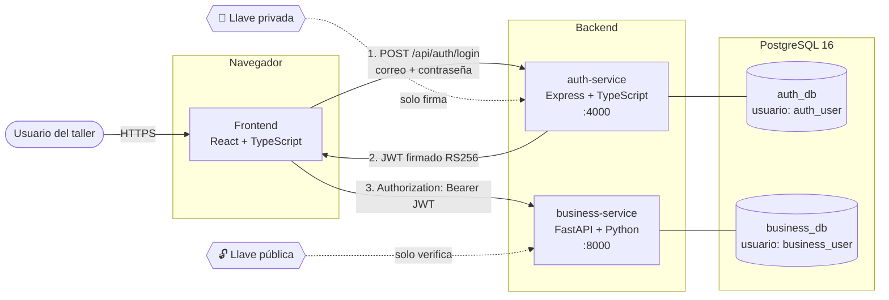
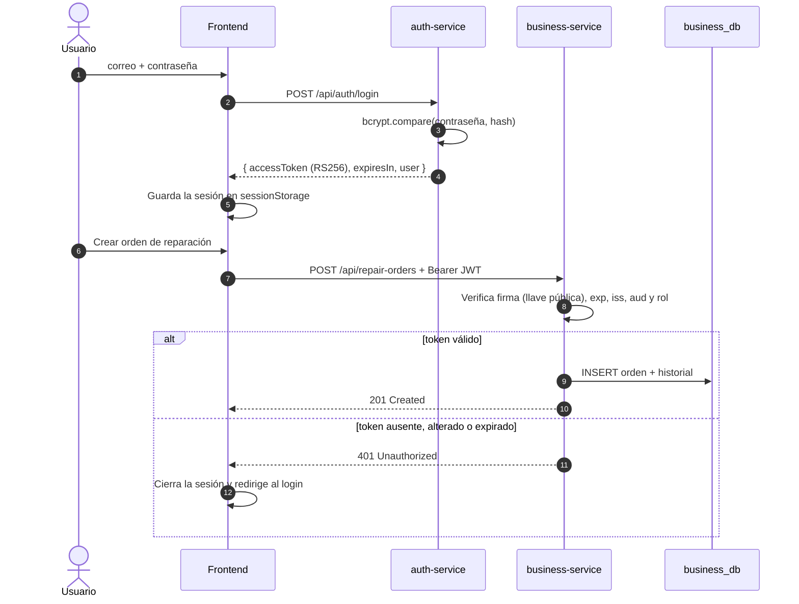
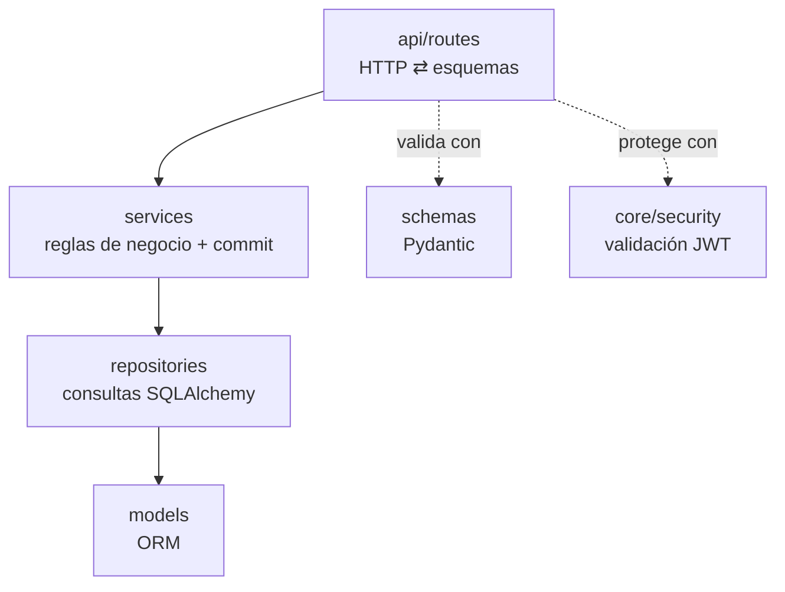

# Arquitectura

## 1. Vista general

La solución es una aplicación distribuida con **dos APIs independientes** y un **frontend web**. Cada servicio tiene una única responsabilidad y su propia base de datos.



| Componente | Responsabilidad | NO hace |
|---|---|---|
| **auth-service** | Identidad: usuarios, roles, hash de contraseñas, login y emisión de JWT | No conoce clientes, motores ni órdenes |
| **business-service** | Negocio: clientes, motores, órdenes de reparación e historial de estados | No almacena contraseñas, no tiene login, no puede emitir tokens |
| **frontend** | Interfaz: login, sesión, dashboard, formularios y consultas | No decide permisos de forma confiable (los backends validan siempre) |
| **PostgreSQL** | Persistencia: una base de datos y un usuario por servicio | — |

## 2. Flujo de una petición protegida



## 3. Arquitectura interna de cada servicio

### auth-service (Express)

```
src/
├── config/env.ts          # Variables de entorno validadas con Zod (fail fast) + carga de la llave
├── database/              # DataSource de TypeORM, migraciones versionadas y seed del admin
├── entities/User.ts       # Entidad y DTO público (nunca expone el hash)
├── middlewares/           # authenticate (JWT), authorize (roles), validate (Zod), error-handler
├── modules/
│   ├── auth/              # routes → controller → service  (login, me, register)
│   └── users/             # routes → controller → service  (consulta, actualización, (des)activación)
├── utils/                 # jwt (firma/verificación), password (bcrypt), http-error
├── docs/openapi.ts        # Especificación OpenAPI servida en /docs
├── app.ts                 # Construye la app (testeable con Supertest)
└── server.ts              # Arranque: migraciones → seed → listen → apagado ordenado
```

### business-service (FastAPI)

Separación estricta en capas, tal como pide el requerimiento:



```
app/
├── core/          # config (pydantic-settings), security (JWT), errors (manejo centralizado)
├── db/            # engine y sesión de SQLAlchemy
├── models/        # Client, Engine, RepairOrder, RepairOrderStatusHistory
├── schemas/       # Contratos de entrada/salida (validación) y paginación
├── repositories/  # Acceso a datos (sin reglas de negocio, sin commit)
├── services/      # Reglas de negocio y máquina de estados de las órdenes
├── api/routes/    # Endpoints REST (delgados)
└── main.py        # Creación de la app, CORS, manejadores de error, routers
alembic/           # Migraciones versionadas del esquema
```

### frontend (React)

```
src/
├── api/           # Cliente HTTP (token, errores tipados) + funciones por endpoint + tipos
├── auth/          # AuthContext (sesión), ProtectedRoute, lectura de expiración del token
├── components/    # Layout, StatusBadge, Toast, componentes de UI reutilizables
├── pages/         # Login, Dashboard, Clientes, Motores, Órdenes, Usuarios
└── utils/         # Etiquetas en español, formato de fechas, filtros en la URL
```

Librerías: **React Router** (navegación), **TanStack Query** (caché, estados de carga y error), **React Hook Form + Zod** (formularios validados).

## 4. Decisiones técnicas

| Decisión | Alternativas | Justificación |
|---|---|---|
| **JWT RS256 (asimétrico)** | HS256 con secreto compartido | Solo auth-service puede firmar; business-service solo verifica con la llave pública. Si business-service se viera comprometido, no podría fabricar tokens. Cumple "compartir una configuración segura de validación sin duplicar la responsabilidad de autenticación". |
| **Una base de datos y un usuario por servicio** | Un esquema compartido | El aislamiento lo garantiza PostgreSQL con permisos (`REVOKE ALL ... FROM PUBLIC`), no una convención del código. Ningún servicio puede leer las tablas del otro. |
| **Sin FK entre servicios** | Referenciar `users.id` desde las órdenes | Las órdenes guardan `created_by_user_id` y `created_by_email` tomados del JWT como dato de referencia. Así business-service no depende de la base de datos de auth-service. |
| **Migraciones versionadas** (TypeORM / Alembic) | `synchronize: true` / `create_all()` | El esquema es reproducible y auditable, y nunca cambia de forma implícita. Las pruebas de business-service ejecutan las migraciones reales. |
| **Registro solo por administradores** | Auto-registro público | Es una aplicación interna del taller. Un seed idempotente crea el primer administrador a partir de variables de entorno. |
| **Máquina de estados en el backend** | Permitir cualquier cambio de estado | Garantiza un flujo coherente. Además, el backend informa `allowed_next_statuses` para que la interfaz solo ofrezca transiciones válidas. |
| **Desactivación lógica** (`is_active`) | Borrado físico | Conserva el historial de órdenes; el requerimiento habla de "estado activo o inactivo". |
| **Express 5** | Express 4 | Propaga automáticamente los errores de funciones `async` al manejador centralizado, sin necesidad de `try/catch` en cada ruta. |
| **sessionStorage para el token** | localStorage / cookie httpOnly | Se borra al cerrar la pestaña y no se comparte entre pestañas. Una cookie httpOnly requeriría el mismo dominio o un proxy y protección CSRF, lo que es más complejo de lo que pide la prueba. |

## 5. Alcance respecto a la edición

El enunciado dice "no se requiere flujo de modificación" (sección 3), pero también pide "listado, creación, **edición** y consulta" de clientes y motores, y "**actualización del estado**" de la orden (sección 4.5). Se resolvió así:

- **Clientes y motores**: se pueden crear, consultar, listar y **editar**, incluido activar o desactivar.
- **Órdenes**: se pueden crear, consultar y listar. **No** se editan libremente; evolucionan solo mediante **cambios de estado auditados**. Cada cambio de estado puede registrar el diagnóstico o el trabajo realizado y queda en el historial.
