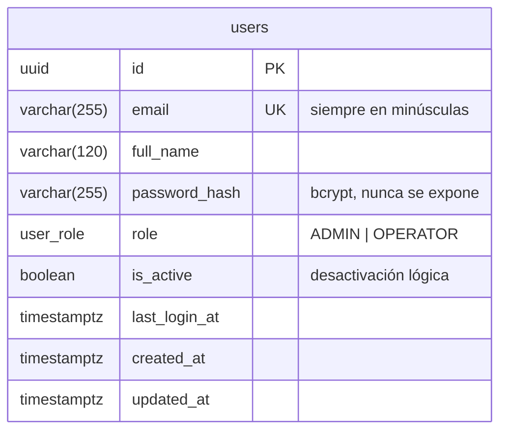
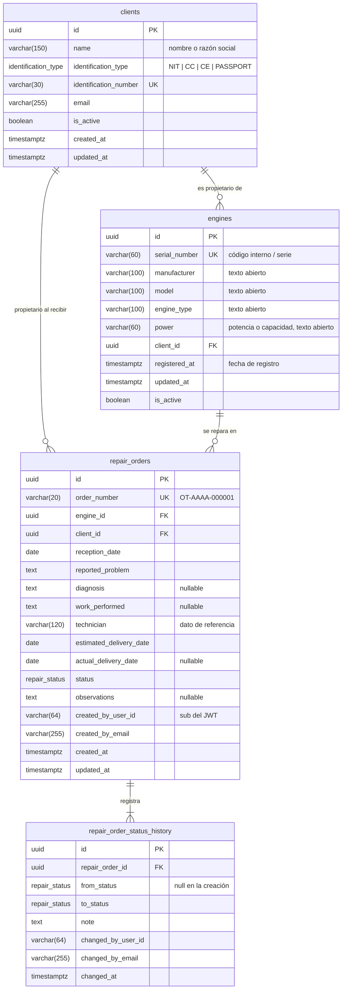
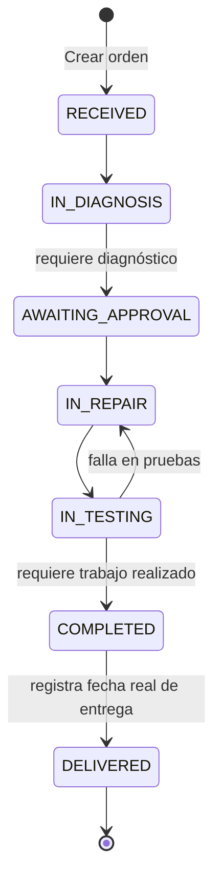

# Modelo de datos

La persistencia usa **PostgreSQL 16** con **dos bases de datos independientes** en la misma instancia:

| Base de datos | Usuario | Dueño | Tablas |
|---|---|---|---|
| `auth_db` | `auth_user` | auth-service | `users`, `migrations` |
| `business_db` | `business_user` | business-service | `clients`, `engines`, `repair_orders`, `repair_order_status_history`, `alembic_version` |

`infra/postgres/init/01-create-databases.sh` crea ambas bases de datos y revoca el acceso público (`REVOKE ALL ON DATABASE ... FROM PUBLIC`). Por eso `business_user` **no puede conectarse** a `auth_db`, y viceversa:

```text
$ psql -U business_user -d auth_db
FATAL: permission denied for database "auth_db"
DETAIL: User does not have CONNECT privilege.
```

## 1. auth_db



## 2. business_db



### Relación con los usuarios

Entre `business_db` y `auth_db` **no hay claves foráneas**. Las órdenes y el historial guardan el `sub` (id) y el correo del usuario **tal como venían en el JWT verificado**. Así se consigue:

- Trazabilidad: se sabe quién creó cada orden y quién hizo cada cambio de estado.
- Independencia: business-service funciona aunque auth-service esté caído, y nunca consulta sus tablas.

## 3. Reglas de integridad

| Regla | Dónde se aplica |
|---|---|
| Correo de usuario único (sin distinguir mayúsculas) | Validación con Zod (pasa a minúsculas) + `UNIQUE (email)` |
| Número de identificación del cliente único | Servicio (409) + `UNIQUE (identification_number)`; se normaliza en mayúsculas y sin espacios |
| Número de serie del motor único | Servicio (409) + `UNIQUE (serial_number)`; se normaliza en mayúsculas |
| Número de orden único y consecutivo | Secuencia `repair_order_number_seq` (segura con concurrencia) + `UNIQUE` |
| Un motor solo pertenece a un cliente activo | Servicio (`BUSINESS_RULE_VIOLATION`) |
| Las órdenes solo se crean para motores y clientes activos | Servicio |
| Máximo **una orden abierta** (no entregada) por motor | Servicio + índice único parcial `uq_repair_orders_one_open_per_engine WHERE status <> 'DELIVERED'` |
| Entrega estimada ≥ recepción; entrega real ≥ recepción | Esquema Pydantic / servicio + `CHECK` en la base de datos |
| No se borra un cliente o un motor con datos asociados | `FOREIGN KEY ... ON DELETE RESTRICT` |

Las reglas se validan primero en la aplicación, para dar mensajes claros, y se repiten en la base de datos (defensa en profundidad). Si una condición de carrera llegara a violar una restricción, el manejador global la convierte en un `409 Conflict`.

## 4. Máquina de estados de la orden



| Código | Etiqueta en la interfaz |
|---|---|
| `RECEIVED` | Recibido |
| `IN_DIAGNOSIS` | En diagnóstico |
| `AWAITING_APPROVAL` | Esperando aprobación |
| `IN_REPAIR` | En reparación |
| `IN_TESTING` | En pruebas |
| `COMPLETED` | Finalizado |
| `DELIVERED` | Entregado |

## 5. Inicialización

| Paso | Cuándo | Qué hace |
|---|---|---|
| `infra/postgres/init/01-create-databases.sh` | Primer arranque del contenedor de PostgreSQL (volumen vacío) | Crea las bases de datos y los usuarios aislados |
| Migraciones de TypeORM | Al iniciar auth-service (`server.ts`) o con `npm run migrate` | Crea la tabla `users` |
| Seed del administrador | Al iniciar auth-service | Crea `ADMIN_EMAIL` si no existe (idempotente) |
| `alembic upgrade head` | Al iniciar el contenedor de business-service | Crea las tablas de negocio, la secuencia, los índices y los `CHECK` |
