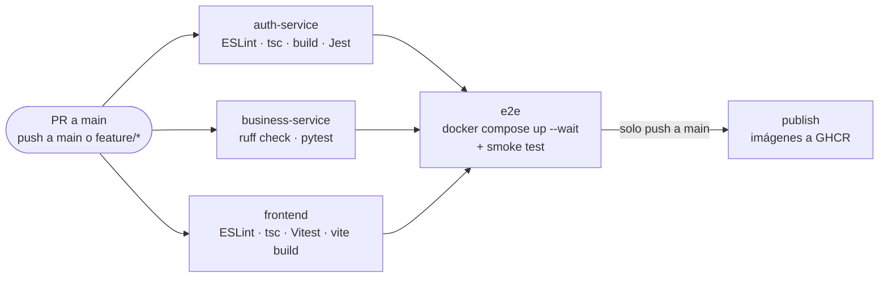

# Pruebas automatizadas y CI/CD

## 1. Estrategia de pruebas

| Servicio | Herramientas | Tipo | Qué cubre |
|---|---|---|---|
| auth-service | Jest, ts-jest, Supertest | Unitarias + integración con PostgreSQL real | Firma y verificación de JWT (firma alterada, expiración, otra llave, emisor/audiencia, confusión de algoritmo, rol desconocido), bcrypt, login, registro, roles, actualización, (des)activación, validaciones y formato de errores |
| business-service | pytest, TestClient (httpx) | Integración con PostgreSQL real **creado con las migraciones de Alembic** | Validación de JWT (todos los ataques anteriores más `alg: none`), CRUD de clientes y motores, duplicados, filtros, paginación, máquina de estados, reglas de negocio e historial |
| frontend | Vitest, Testing Library, jsdom | Componentes + unidades | Validación del login, manejo de errores de la API, almacenamiento de la sesión, envío del token, cierre de sesión ante 401, formulario de cambio de estado |
| Plataforma | `scripts/smoke-test.mjs` | Extremo a extremo (E2E) sobre Docker Compose | Login real → JWT → business-service rechaza peticiones sin token o con token alterado → cliente → motor → orden → ciclo completo hasta "Entregado" |

Las pruebas **nunca usan llaves ni secretos reales**: cada ejecución genera un par RSA efímero.

### Ejecutar localmente

Se necesita un PostgreSQL accesible (por ejemplo, el de `docker compose up -d postgres`) y las bases de datos de prueba:

```bash
docker exec -it motor-repair-postgres psql -U postgres -c "CREATE DATABASE auth_test" -c "CREATE DATABASE business_test"
```

```bash
# auth-service
cd auth-service && npm install
TEST_DB_PASSWORD=<POSTGRES_PASSWORD> npm test

# business-service
cd business-service && python -m venv .venv && source .venv/bin/activate   # Windows: .venv\Scripts\activate
pip install -r requirements-dev.txt
TEST_DATABASE_URL=postgresql+psycopg://postgres:<POSTGRES_PASSWORD>@localhost:5432/business_test pytest -v

# frontend (no necesita base de datos)
cd frontend && npm install && npm test

# E2E con toda la plataforma levantada
docker compose up -d --build && node scripts/smoke-test.mjs
```

Variables de la base de datos de pruebas: `TEST_DB_HOST`, `TEST_DB_PORT`, `TEST_DB_NAME`, `TEST_DB_USER` y `TEST_DB_PASSWORD` (auth-service), y `TEST_DATABASE_URL` (business-service). Por defecto apuntan a `localhost:5432` con usuario `postgres` y contraseña `postgres`.

## 2. Pipeline de GitHub Actions

Archivo: [`.github/workflows/ci.yml`](../.github/workflows/ci.yml)



| Job | Se ejecuta en | Validaciones |
|---|---|---|
| `auth-service` | Todos los eventos | Lint, chequeo de tipos, compilación y pruebas con cobertura, con un contenedor de PostgreSQL |
| `business-service` | Todos los eventos | `ruff check` (incluye reglas de seguridad tipo bandit e higiene de imports) y pytest con PostgreSQL |
| `frontend` | Todos los eventos | Lint, chequeo de tipos, pruebas y build de producción |
| `e2e` | Si los tres anteriores pasan | **Despliegue automatizado en un entorno de pruebas efímero**: construye las 3 imágenes, levanta la plataforma completa con Docker Compose, espera los healthchecks y ejecuta la prueba de humo entre servicios |
| `publish` | Solo en push a `main` y tras pasar `e2e` | Construye y publica las imágenes en GitHub Container Registry con las etiquetas `latest` y el SHA del commit |

### Proteger la rama principal

Para que el pipeline **bloquee** los cambios con errores antes de integrarlos, configure en GitHub *Settings → Branches → Add branch ruleset* para `main`:

1. Exigir pull request antes de hacer merge.
2. Exigir que pasen los checks `Auth service (Express)`, `Business service (FastAPI)`, `Frontend (React)` y `Despliegue en entorno de pruebas + smoke test`.

## 3. Evidencia de ejecución

- **Pruebas locales**: [`docs/evidence/`](evidence/) explica cómo generar y guardar la salida de cada suite y de la prueba de humo.
- **Pipeline**: la pestaña *Actions* del repositorio muestra cada ejecución con sus logs. Para la entrega, adjunte una captura de una ejecución en verde.
